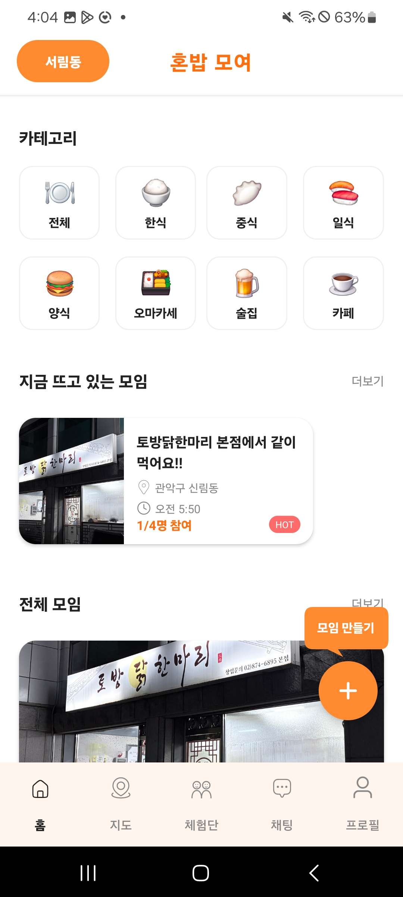
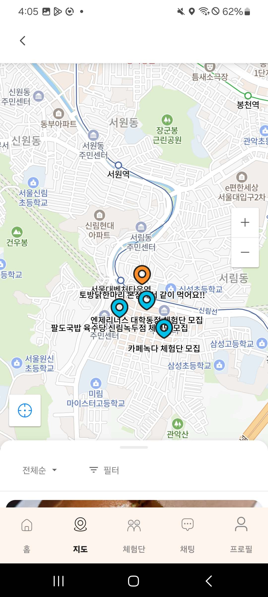
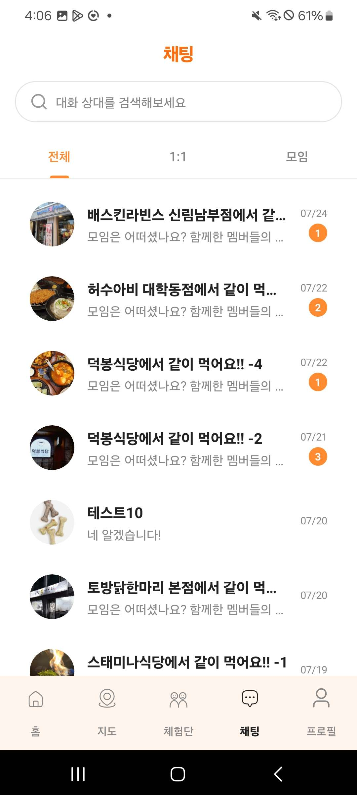
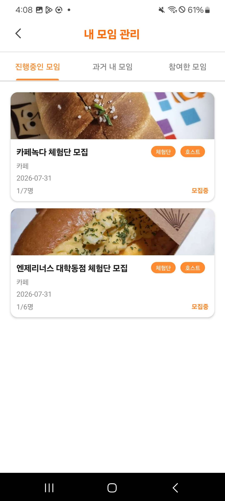

<div align="center">


**근처에서 같이 밥 먹을 사람을 찾는 모임 앱**

<sub>개인 프로젝트 · 2025.12 ~ 2026.09 · 앱 · 서버 · DB 1인 개발</sub>

<br/><br/>


<a href="https://github.com/Ju-unn/honbabapp-backend"></a>

<br/><br/>

&nbsp;
&nbsp;
&nbsp;


<sub>홈 · 지도 · 채팅 · 내 모임</sub>

</div>

<br/>

## 왜 만들었나

경상도에서 서울로 올라와 혼자 밥을 먹는 날이 많았어요. 그러다 **같이 먹을 사람이 근처에 있으면 좋겠다**는 생각이 들었습니다.

그래서 지도로 주변 밥 모임을 찾고, 처음 만난 사람끼리 함께 밥을 먹는 앱을 만들었어요. 모르는 사람과 만나는 일이라 **서로 믿을 수 있게 하는 장치**를 가장 신경 썼습니다.

## 어떻게 쓰나

```
지도에서 주변 모임 찾기 → 참여 신청 → 채팅으로 약속 → QR 출석 → 매너 점수
```

- 지도에서 지금 화면에 보이는 곳의 밥 모임을 찾아요.
- 참여하면 모임 채팅방에서 시간과 장소를 맞춰요.
- 만나서 **QR로 출석**을 찍고, 밥을 먹은 뒤 서로 **매너 점수**를 남겨요.
- **체험단 모임**은 함께 먹은 뒤 후기를 쓰면 밥값 일부를 지원받아요.

## 내가 한 것

앱, 서버, DB, 실시간 채팅을 **9개월 동안 혼자** 만들었어요.

- **지도가 화면에 보이는 범위만 조회하게 바꿨어요.** 처음엔 서버가 모임 전체를 내려주고 앱이 화면 안의 것만 골랐어요. 모임이 늘수록 느려져서 서버 쿼리부터 바꿨습니다.
  - 가상 모임 1만 건으로 로컬에서 잰 값: 응답 **14.98MB → 58.9KB**, 서버 처리 **545ms → 16ms**, 쿼리 **10,001번 → 39번**
  - 앱은 지도가 멈추고 500ms 뒤에 한 번만 요청하고, 결과가 같으면 마커를 다시 그리지 않아요.
- **특정 사진만 업로드에 실패하던 문제**의 원인을 로그로 찾고, 올리기 전에 앱에서 압축했어요. 사진 한 장이 **7.33MB → 0.45MB**로 줄었어요.
- 앱을 켤 때 요청 여러 개가 동시에 401을 받으면 강제 로그아웃이 났어요. **토큰 재발급이 한 번만 일어나게** 고쳤어요.
- Socket.IO 실시간 채팅, FCM 푸시 알림, QR 출석, 카카오 · 구글 로그인을 붙였어요.

<br/>

          

## 더 알아보기

- 📐 [시스템 구조와 지도 개선 과정](docs/구조.md)
- 🗄️ [서버 저장소 (PHP · MySQL)](https://github.com/Ju-unn/honbabapp-backend)

---

<sub>만든 사람 [@Ju-unn](https://github.com/Ju-unn)</sub>
