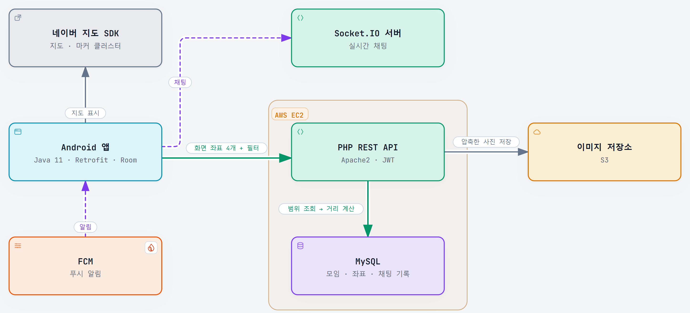

# 혼밥모여 구조와 문제 해결

[← README로 돌아가기](../README.md)

## 시스템 구조

| 구성 | 기술 | 하는 일 |
|---|---|---|
| Android 앱 | Java 11, Retrofit, OkHttp, Room | 화면, 지도, 채팅, 보내지 못한 메시지 임시 저장 |
| 지도 | 네이버 지도 SDK | 지도 표시, 마커 묶기(클러스터) |
| 서버 | PHP REST API, Apache2, JWT (AWS EC2) | 모임, 회원, 출석, 후기 |
| DB | MySQL (AWS EC2) | 모임, 좌표, 채팅 기록 |
| 실시간 | Socket.IO 서버 | 채팅 |
| 사진 | S3 | 압축한 사진 저장 |
| 알림 | FCM | 푸시 알림 |

## 지도: 화면에 보이는 범위만 조회

### 문제

| 원인 | 내용 |
|---|---|
| 전체 조회 | 화면과 상관없이 DB의 모임 1만 건을 조회했어요. 쿼리 10,001번, 545ms, 응답 14.98MB |
| 중복 요청 | 지도가 멈출 때마다(카메라 idle 이벤트) 바로 서버에 요청했어요 |
| 다시 그리기 | 결과가 같아도 마커를 전부 다시 그렸고, 늦게 온 응답이 최신 핀을 덮어썼어요 |

### 해결

1. **서버: 범위 조회 (PHP, MySQL)**
   - 앱이 화면의 남서쪽과 북동쪽 좌표 4개를 보내면, 그 사각형 안의 모임만 최대 50건 조회해요.
   - 지도 화면이 사각형이라 원(반경)보다 보이는 영역과 정확히 맞아요.
2. **앱: 요청 줄이기 (Java, Retrofit)**
   - 지도가 마지막으로 멈추고 500ms 뒤에 한 번만 요청하고, 이전 요청은 `cancel()`로 취소해요.
   - 300ms는 잠깐 멈출 때마다 DB 호출이 늘었고, 1초는 핀이 늦게 떴어요.
3. **앱: 다시 그리지 않기 (네이버 지도 SDK)**
   - 직전에 그린 모임 ID 목록과 같으면 마커를 다시 만들지 않아서 깜빡임이 없어요.
   - 화면이 사라질 때 마커 묶음을 풀어서 메모리가 새지 않아요.

### 결과

가상 모임 1만 건, 화면 범위 3곳 평균으로 로컬에서 잰 값이에요.

| | 바꾸기 전 | 바꾼 뒤 |
|---|---|---|
| 응답 크기 | 14.98MB | 58.9KB |
| 서버 처리 | 545ms | 16ms |
| 쿼리 수 | 10,001번 | 39번 |

이제 조회량이 전체 모임 수가 아니라 **화면에 보이는 모임 수**에 비례해요.

### 검토한 다른 방법

- **앱에서 요청만 줄이기(디바운스)**: 요청 수는 줄지만 요청마다 서버가 여전히 1만 건을 조회해요.
- **중심점과 반경으로 조회**: 원이라서 사각형 화면과 영역이 어긋나요.
- **마커 묶기(클러스터링)**: 그리는 마커만 줄고 조회량과 전송량은 그대로라서, 범위 조회와 함께 써요.

### 남은 일

좌표가 문자열 칸이라 숫자로 바꿔(CAST) 비교하기 때문에 인덱스를 타지 못해요. 로컬에서 숫자 칸에 인덱스를 걸어 보니 강남역 화면 범위 조회가 15.0ms → 10.4ms로 줄어서, 다음 단계로 정해 두었어요.

## 그 밖의 문제

### 동시에 401을 받아도 토큰 재발급은 한 번만

- **원인**: 서버는 리프레시 토큰을 한 번 쓰면 폐기해요. 앱을 켤 때 동시에 나간 요청 3개가 각자 재발급을 시도했고, 늦은 요청이 실패해서 로그인 상태인데도 강제 로그아웃이 났어요.
- **해결**: OkHttp Authenticator 안을 잠가서 한 요청만 재발급하게 했어요. 나머지 요청은 저장된 토큰과 비교해서 재발급 없이 새 토큰으로 다시 시도해요. 재발급에 성공하면 소켓도 다시 로그인해요.

### 특정 사진만 실패하던 업로드

- **원인**: 서버는 용량을 넘어도 HTTP 200과 `success=false`로 응답했는데, 앱이 `message`를 버려서 원인을 몰랐어요. 로그를 남기니 원본 7.33MB가 서버 제한 5MB를 넘고 있었어요.
- **해결**: 서버 제한을 늘리면 더 큰 원본에서 다시 실패해요. 그래서 올리기 전에 앱에서 긴 변 1280px, JPEG 품질 85로 압축했어요. 큰 사진은 `inSampleSize`로 줄여서 열어요.
- **결과**: 7.33MB → 0.45MB. 같은 S3 공간에 약 16배 더 저장할 수 있어요.
